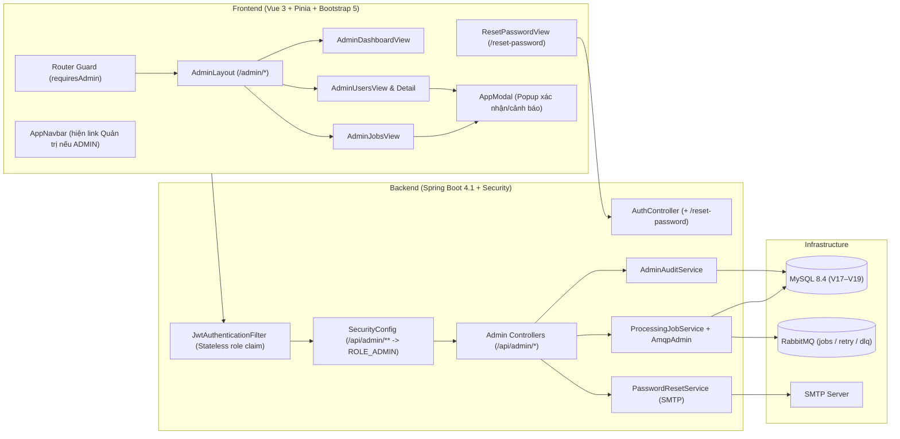

# Kế hoạch Triển khai: Admin Management Module — Phase 1 (Core MVP)

## Goal Description

Triển khai **Phase 1 (Core MVP)** của phân hệ quản trị (**Admin Portal**) cho **SubLearn** dựa trên các quyết định đã chốt trong `_specs/admin-management-module.md`, bao gồm:
1. **Module 1 — RBAC & Bảo mật**: Phân quyền 2 vai trò (`USER` / `ADMIN`), trạng thái tài khoản (`ACTIVE` / `LOCKED`), JWT stateless mang claim `role`, và khởi tạo Admin bootstrap từ `.env`.
2. **Module 8 (Backend) — Audit Log**: Bảng `admin_audit_log` và dịch vụ ghi log tự động ở Backend ngay từ Phase 1 cho mọi thao tác thay đổi dữ liệu của Admin.
3. **Module 2 — Dashboard Tổng quan & Sức khỏe Hệ thống**: Chỉ số KPI theo khoảng thời gian, biểu đồ xu hướng theo ngày, phân bố lỗi theo `FailureReason`, và giám sát sức khỏe MySQL / RabbitMQ (3 queue) / `yt-dlp` / Google Gemini.
4. **Module 3 — Quản lý Người dùng**: Danh sách phân trang/tìm kiếm/lọc, trang chi tiết thống kê học tập, Khóa/Mở khóa (không xóa tài khoản user), thay đổi vai trò, cưỡng chế đăng xuất toàn bộ thiết bị, và gửi link đặt lại mật khẩu qua SMTP kèm trang công khai `/reset-password`.
5. **Module 5 — Quản lý Processing Jobs & Hàng đợi RabbitMQ**: Tra cứu/lọc DB-driven trên `processing_job`, Retry đơn lẻ, Bulk Retry giới hạn tối đa N job/lượt, hủy/force-fail job treo, hiển thị tồn 3 queue RabbitMQ và Purge DLQ — toàn bộ cảnh báo/xác nhận sử dụng `FE/src/components/common/AppModal.vue`.



---

## User Review Required

> [!IMPORTANT]
> **Biến môi trường mới trong `.env` & `docker-compose.yml`:**
> Phase 1 bổ sung các biến cấu hình cho **Admin Bootstrap**, **SMTP Email**, và **Bulk Retry limit**:
> - `ADMIN_BOOTSTRAP_EMAIL` & `ADMIN_BOOTSTRAP_PASSWORD` (tự tạo hoặc nâng quyền tài khoản `ADMIN` khi khởi động).
> - `MAIL_HOST`, `MAIL_PORT`, `MAIL_USERNAME`, `MAIL_PASSWORD`, `MAIL_FROM` (nếu bỏ trống ở môi trường dev, ứng dụng vẫn khởi động bình thường và chỉ trả lỗi `SMTP_NOT_CONFIGURED` hiển thị trong popup `AppModal` khi Admin bấm gửi link đặt lại mật khẩu).
> - `ADMIN_BULK_RETRY_MAX_BATCH` (mặc định `20` job/lượt).

> [!WARNING]
> **Lưu ý về bảo mật JWT Stateless & API Logging:**
> - Theo thiết kế đã chốt, `JwtAuthenticationFilter` giữ hoàn toàn stateless (đọc `role` trực tiếp từ JWT claim), nên tài khoản vừa bị khóa (`LOCKED`) hoặc vừa bị hạ quyền vẫn dùng được access token cũ tối đa đến hết TTL **15 phút**; đồng thời toàn bộ `RefreshToken` bị thu hồi ngay lập tức và `login`/`refresh` bị chặn ngay.
> - API đặt lại mật khẩu `POST /api/auth/reset-password` nhận `token` trong **JSON body** (không đặt trong query string) để tránh `ApiLoggingFilter` ghi lộ raw token ra log server.

> [!NOTE]
> **Thư viện biểu đồ Dashboard (FE):**
> Để không phải thêm dependency npm mới cho Frontend (giúp Docker build nhẹ và nhanh), biểu đồ xu hướng (video mới/job lỗi theo ngày, phân bố `FailureReason`) trong Phase 1 sẽ được vẽ trực tiếp bằng **SVG / CSS bar chart** thuần đồng bộ với bảng màu `--brand-*` hiện có.

---

## Proposed Changes

### 1. Dependencies, Migrations & Configuration

#### [MODIFY] `BE/SubLearn/pom.xml`
- Thêm dependency `org.springframework.boot:spring-boot-starter-mail` để hỗ trợ gửi email đặt lại mật khẩu qua SMTP.

#### [NEW] `V17__add_user_role_and_status.sql`
- Vị trí: `BE/SubLearn/src/main/resources/db/migration/V17__add_user_role_and_status.sql`
- Thêm cột `role VARCHAR(20) NOT NULL DEFAULT 'USER'` và `status VARCHAR(20) NOT NULL DEFAULT 'ACTIVE'` vào bảng `app_user`.
- Tạo index `idx_app_user_role_status (role, status)`.

```sql
ALTER TABLE app_user
    ADD COLUMN role VARCHAR(20) NOT NULL DEFAULT 'USER',
    ADD COLUMN status VARCHAR(20) NOT NULL DEFAULT 'ACTIVE';

CREATE INDEX idx_app_user_role_status ON app_user (role, status);
```

#### [NEW] `V18__create_password_reset_token.sql`
- Vị trí: `BE/SubLearn/src/main/resources/db/migration/V18__create_password_reset_token.sql`
- Tạo bảng `password_reset_token`:
  - `id BIGINT AUTO_INCREMENT PRIMARY KEY`
  - `user_id BIGINT NOT NULL` (`FK -> app_user(id) ON DELETE CASCADE`)
  - `created_by_admin_id BIGINT NULL` (`FK -> app_user(id) ON DELETE SET NULL`)
  - `token_hash VARCHAR(64) NOT NULL UNIQUE`
  - `expires_at DATETIME(6) NOT NULL`
  - `used_at DATETIME(6) NULL`
  - `created_at DATETIME(6) NOT NULL`
  - Index `idx_password_reset_token_user_id (user_id)`.

#### [NEW] `V19__create_admin_audit_log.sql`
- Vị trí: `BE/SubLearn/src/main/resources/db/migration/V19__create_admin_audit_log.sql`
- Tạo bảng `admin_audit_log`:
  - `id BIGINT AUTO_INCREMENT PRIMARY KEY`
  - `admin_user_id BIGINT NULL` (`FK -> app_user(id) ON DELETE SET NULL`)
  - `action VARCHAR(50) NOT NULL`
  - `target_type VARCHAR(40) NOT NULL`
  - `target_id VARCHAR(64) NULL`
  - `summary VARCHAR(512) NOT NULL`
  - `details_json TEXT NULL`
  - `ip_address VARCHAR(64) NULL`
  - `created_at DATETIME(6) NOT NULL`
  - Indexes trên `(created_at)`, `(admin_user_id, created_at)`, `(action, created_at)`, `(target_type, target_id)`.

#### [MODIFY] `BE/SubLearn/src/main/resources/application.properties`
- Bổ sung cấu hình Admin, Bulk Retry, Password Reset TTL và SMTP tùy chọn:
  - `sublearn.admin.bootstrap-email=${ADMIN_BOOTSTRAP_EMAIL:}`
  - `sublearn.admin.bootstrap-password=${ADMIN_BOOTSTRAP_PASSWORD:}`
  - `sublearn.admin.bulk-retry-max-batch=${ADMIN_BULK_RETRY_MAX_BATCH:20}`
  - `sublearn.admin.password-reset-ttl-minutes=${PASSWORD_RESET_TTL_MINUTES:30}`
  - `sublearn.frontend.base-url=${FRONTEND_ORIGIN:http://localhost:5173}`
  - `spring.mail.host=${MAIL_HOST:}`, `spring.mail.port=${MAIL_PORT:587}`, `spring.mail.username=${MAIL_USERNAME:}`, `spring.mail.password=${MAIL_PASSWORD:}`, `spring.mail.properties.mail.smtp.auth=${MAIL_SMTP_AUTH:true}`, `spring.mail.properties.mail.smtp.starttls.enable=${MAIL_STARTTLS:true}`, `sublearn.mail.from=${MAIL_FROM:no-reply@sublearn.local}`.

#### [MODIFY] `docker-compose.yml` & `.env.example`
- Truyền các biến `ADMIN_BOOTSTRAP_EMAIL`, `ADMIN_BOOTSTRAP_PASSWORD`, `ADMIN_BULK_RETRY_MAX_BATCH`, `MAIL_HOST`, `MAIL_PORT`, `MAIL_USERNAME`, `MAIL_PASSWORD`, `MAIL_FROM` vào service `backend` và cập nhật chú thích mẫu trong `.env.example`.

---

### 2. Backend — RBAC, Stateless JWT & Admin Bootstrap

#### [NEW] `UserRole.java` & `UserStatus.java`
- `BE/SubLearn/src/main/java/org/example/sublearn/domain/UserRole.java`: `public enum UserRole { USER, ADMIN }`
- `BE/SubLearn/src/main/java/org/example/sublearn/domain/UserStatus.java`: `public enum UserStatus { ACTIVE, LOCKED }`

#### [MODIFY] `BE/SubLearn/src/main/java/org/example/sublearn/domain/AppUser.java`
- Thêm trường `role` (`@Enumerated(EnumType.STRING)`, mặc định `UserRole.USER`) và `status` (`@Enumerated(EnumType.STRING)`, mặc định `UserStatus.ACTIVE`), kèm getter/setter và helper `isLocked()`, `isAdmin()`.

#### [MODIFY] `BE/SubLearn/src/main/java/org/example/sublearn/common/ApiException.java`
- Bổ sung static factory `forbidden(String code, String message)` (`HttpStatus.FORBIDDEN`) và `serviceUnavailable(String code, String message)` (`HttpStatus.SERVICE_UNAVAILABLE`).

#### [MODIFY] `BE/SubLearn/src/main/java/org/example/sublearn/security/JwtService.java`
- Cập nhật `generateAccessToken(Long userId, String email, UserRole role)` thêm claim `"role"`.
- Thêm `record ParsedToken(Long userId, UserRole role)` và `Optional<ParsedToken> parseAccessToken(String token)` (fallback `UserRole.USER` nếu gặp token cũ thiếu claim `role`). Giữ `parseUserId(String token)` ủy quyền qua `parseAccessToken` để tương thích ngược với các test/caller hiện có.

#### [MODIFY] `BE/SubLearn/src/main/java/org/example/sublearn/security/JwtAuthenticationFilter.java`
- Đọc `ParsedToken` từ `jwtService.parseAccessToken(token)` và gán `List.of(new SimpleGrantedAuthority("ROLE_" + parsed.role().name()))` vào `UsernamePasswordAuthenticationToken` (giữ nguyên principal là `Long userId` để mọi `@AuthenticationPrincipal Long userId` hiện tại hoạt động bình thường).

#### [MODIFY] `BE/SubLearn/src/main/java/org/example/sublearn/config/SecurityConfig.java`
- Mở quyền công khai thêm `/api/auth/reset-password`.
- Khóa toàn bộ `.requestMatchers("/api/admin/**").hasRole("ADMIN")`.

#### [MODIFY] `MeResponse.java`, `AuthService.java` & `AuthController.java`
- `BE/SubLearn/src/main/java/org/example/sublearn/auth/dto/MeResponse.java`: bổ sung `UserRole role, UserStatus status`.
- `BE/SubLearn/src/main/java/org/example/sublearn/auth/AuthService.java`:
  - `login()` và `refresh()`: kiểm tra nếu `user.isLocked()` thì ném `ApiException.forbidden("ACCOUNT_LOCKED", "Tài khoản của bạn đã bị khóa. Vui lòng liên hệ quản trị viên.")`.
  - `register()`: luôn tạo user với `UserRole.USER` và `UserStatus.ACTIVE`.
- `BE/SubLearn/src/main/java/org/example/sublearn/auth/AuthController.java`: bổ sung `POST /api/auth/reset-password` nhận `ResetPasswordRequest` (body JSON chứa `token`, `newPassword` >= 8 ký tự).

#### [NEW] `AdminBootstrapRunner.java`
- Vị trí: `BE/SubLearn/src/main/java/org/example/sublearn/admin/AdminBootstrapRunner.java`
- Implement `ApplicationRunner`: khi khởi động, nếu `sublearn.admin.bootstrap-email` không rỗng:
  - Chuẩn hóa email (trim, lowercase), tìm `AppUser`:
    - Nếu đã tồn tại: nâng lên `UserRole.ADMIN` và đặt `UserStatus.ACTIVE` nếu đang khóa; ghi log thông báo (không log mật khẩu).
    - Nếu chưa tồn tại: kiểm tra `sublearn.admin.bootstrap-password` (>= 8 ký tự), tạo tài khoản `AppUser` mới với `UserRole.ADMIN`, `displayName = "Admin"`.

---

### 3. Backend — Audit Log Foundation (Ghi từ Phase 1)

#### [NEW] `AdminAuditAction.java` & `AdminAuditLog.java`
- `BE/SubLearn/src/main/java/org/example/sublearn/domain/AdminAuditAction.java`: Enum các hành động Phase 1 (`LOCK_USER`, `UNLOCK_USER`, `CHANGE_USER_ROLE`, `REVOKE_USER_SESSIONS`, `SEND_PASSWORD_RESET`, `RETRY_JOB`, `BULK_RETRY_JOBS`, `FORCE_FAIL_JOB`, `PURGE_DLQ`).
- `BE/SubLearn/src/main/java/org/example/sublearn/domain/AdminAuditLog.java`: Entity ánh xạ bảng `admin_audit_log`.

#### [NEW] `AdminAuditLogRepository.java` & `AdminAuditService.java`
- `BE/SubLearn/src/main/java/org/example/sublearn/repository/AdminAuditLogRepository.java`
- `BE/SubLearn/src/main/java/org/example/sublearn/admin/AdminAuditService.java`:
  - Cung cấp `record(Long adminUserId, AdminAuditAction action, String targetType, String targetId, String summary, Map<String, Object> details, String ipAddress)`.
  - Serialize `details` bằng Jackson 3 (`tools.jackson.databind.ObjectMapper`) sau khi loại bỏ các key nhạy cảm (`password`, `token`, `secret`, `apiKey`, `cookies`).
  - Helper trích xuất IP client từ `HttpServletRequest` (ưu tiên `X-Forwarded-For` đầu tiên do chạy sau Nginx, fallback `getRemoteAddr()`).

---

### 4. Backend — SMTP Password Reset

#### [NEW] `PasswordResetToken.java` & `PasswordResetTokenRepository.java`
- `BE/SubLearn/src/main/java/org/example/sublearn/domain/PasswordResetToken.java`: Entity ánh xạ `password_reset_token`, các hàm `isUsable(Instant now)`, `markUsed(Instant now)`.
- `BE/SubLearn/src/main/java/org/example/sublearn/repository/PasswordResetTokenRepository.java`: Hỗ trợ `findByTokenHash(String tokenHash)` và `@Modifying invalidateActiveTokensForUser(Long userId, Instant now)`.

#### [NEW] `ResetPasswordRequest.java` & `PasswordResetService.java`
- `BE/SubLearn/src/main/java/org/example/sublearn/auth/dto/ResetPasswordRequest.java`
- `BE/SubLearn/src/main/java/org/example/sublearn/admin/PasswordResetService.java`:
  - Inject `ObjectProvider<JavaMailSender>` để app vẫn khởi động bình thường khi chưa cấu hình `MAIL_HOST`.
  - `sendResetEmailByAdmin(Long targetUserId, Long adminUserId, String ipAddress)`: kiểm tra `mailHost` và `JavaMailSender` khả dụng (`SMTP_NOT_CONFIGURED` nếu thiếu) -> vô hiệu hóa token cũ -> sinh raw token 32 bytes (Base64URL), lưu hash bằng `Sha256.hash(rawToken)` với `expiresAt = now + 30m` -> gửi email chứa `${frontendBaseUrl}/reset-password?token=${rawToken}` -> ghi `AdminAuditLog` (`SEND_PASSWORD_RESET`, không ghi raw token).
  - `completePasswordReset(String rawToken, String newPassword)`: kiểm tra hash tồn tại, `usedAt == null`, `expiresAt > now` (`INVALID_OR_EXPIRED_RESET_TOKEN` nếu không hợp lệ) -> mã hóa mật khẩu mới -> `token.markUsed(now)` -> thu hồi toàn bộ `RefreshToken` của user đó.

---

### 5. Backend — Admin Dashboard & System Health (Module 2)

#### [MODIFY] `RabbitMqConfig.java` & Repositories
- `BE/SubLearn/src/main/java/org/example/sublearn/job/RabbitMqConfig.java` và `AmqpAdmin`: đọc `QUEUE_MESSAGE_COUNT` cho 3 queue (`sublearn.video.jobs`, `sublearn.video.jobs.retry`, `sublearn.video.jobs.dlq`) và purge DLQ.
- Mở rộng các repository hiện có bằng JPQL query tối ưu (tránh load entity dư thừa và tránh N+1):
  - `BE/SubLearn/src/main/java/org/example/sublearn/repository/AppUserRepository.java`: `countByRole`, `countByCreatedAtAfter`, `searchAdminUsers(search, role, status, pageable)`.
  - `BE/SubLearn/src/main/java/org/example/sublearn/repository/RefreshTokenRepository.java`: `countByUser_IdAndRevokedFalseAndExpiresAtAfter`, `@Modifying revokeAllActiveByUserId(Long userId)`.
  - `BE/SubLearn/src/main/java/org/example/sublearn/repository/VideoRepository.java`: `countByStatus`, `countByCreatedAtAfter`, `countByRequestedByUser_Id`, query tổng hợp số video tạo mới theo ngày.
  - `BE/SubLearn/src/main/java/org/example/sublearn/repository/ProcessingJobRepository.java`: `countByStatus`, `countByJobTypeAndStatus`, thống kê theo `FailureReason` & job lỗi theo ngày, query tìm kiếm/lọc đa điều kiện với `@EntityGraph(attributePaths = {"video", "requestedByUser"})`.
  - `BE/SubLearn/src/main/java/org/example/sublearn/repository/WordMeaningCacheRepository.java`: `countByStatus(WordMeaningStatus status)`.
  - `UserVideoRepository.java`, `DictionaryEntryRepository.java`, `DictionaryFolderRepository.java`, `VideoWatchHistoryRepository.java`: bổ sung hàm `countByUser_Id` và lấy top 10 lịch sử xem gần nhất.

#### [NEW] `AdminDashboardService.java`, `AdminHealthService.java`, `AdminDashboardController.java` & DTOs
- Vị trí: `BE/SubLearn/src/main/java/org/example/sublearn/admin/` và `.../admin/dto/`
- `GET /api/admin/dashboard/overview?range=24h|7d|30d|all`: trả về KPI users, videos theo trạng thái, jobs theo loại & trạng thái, tỉ lệ thành công, `wordMeaningCache` (`READY`/`FAILED`), tổng `dictionaryEntries`, chuỗi xu hướng theo ngày (`dailyVideos`, `dailyFailedJobs`), và bảng phân bố theo `FailureReason`.
- `GET /api/admin/dashboard/health`:
  - `mysql`: `UP`/`DOWN` (kiểm tra `DataSource` / `SELECT 1`).
  - `rabbitmq`: `UP`/`DOWN` + số lượng message tồn trong 3 queue qua `AmqpAdmin.getQueueProperties(...)`.
  - `ytDlp`: kiểm tra `yt-dlp --version` (timeout 3s) + trạng thái file cookies (`cookiesConfigured: boolean`, không trả nội dung).
  - `gemini`: `apiKeyConfigured: boolean`, `model`, số job lỗi `TRANSLATION_FAILED` trong 24h gần nhất.

---

### 6. Backend — Admin User Management (Module 3)

#### [NEW] `AdminUserService.java`, `AdminUserController.java` & DTOs
- Vị trí: `BE/SubLearn/src/main/java/org/example/sublearn/admin/` và `.../admin/dto/`
- Endpoints:
  - `GET /api/admin/users?search=&role=&status=&page=0&size=20` — danh sách phân trang kèm thống kê nhanh.
  - `GET /api/admin/users/{id}` — chi tiết user (thông tin tài khoản, số phiên `RefreshToken` đang hoạt động, số video thư viện, số video submit, số từ vựng, số folder, 10 video xem gần nhất).
  - `PATCH /api/admin/users/{id}/status` `{ status: "ACTIVE" | "LOCKED" }` — chặn tự khóa chính mình (`CANNOT_LOCK_SELF`), chặn khóa `ADMIN` cuối cùng đang hoạt động (`CANNOT_LOCK_LAST_ADMIN`), khi chuyển `LOCKED` thì thu hồi toàn bộ `RefreshToken` + ghi `AdminAuditLog`.
  - `PATCH /api/admin/users/{id}/role` `{ role: "USER" | "ADMIN" }` — chặn tự hạ quyền (`CANNOT_DEMOTE_SELF`), chặn hạ quyền `ADMIN` cuối cùng (`CANNOT_DEMOTE_LAST_ADMIN`), khi hạ về `USER` thì thu hồi toàn bộ `RefreshToken` + ghi `AdminAuditLog`.
  - `POST /api/admin/users/{id}/revoke-sessions` — thu hồi toàn bộ `RefreshToken` đang active, trả về `revokedCount` + ghi `AdminAuditLog`.
  - `POST /api/admin/users/{id}/send-password-reset` — gọi `PasswordResetService.sendResetEmailByAdmin(...)`.
- Tuyệt đối **không tạo** endpoint xóa user (`DELETE /api/admin/users/{id}`).

---

### 7. Backend — Admin Processing Jobs & Queue Management (Module 5)

#### [NEW] `AdminJobService.java`, `AdminJobController.java` & DTOs
- Vị trí: `BE/SubLearn/src/main/java/org/example/sublearn/admin/` và `.../admin/dto/`
- Endpoints:
  - `GET /api/admin/jobs?status=&jobType=&failureReason=&videoId=&search=&from=&to=&page=0&size=20` — danh sách phân trang kèm `youtubeVideoId`, `videoTitle`, `requestedByEmail`, sắp xếp `createdAt DESC`.
  - `POST /api/admin/jobs/{id}/retry` — chỉ cho phép khi `status == FAILED` (`409 Conflict` mã `JOB_NOT_RETRYABLE` nếu khác), gọi `processingJobService.retryJob(id, adminUserId)` (giữ nguyên job cũ làm lịch sử, tạo job mới đẩy RabbitMQ) + ghi `AdminAuditLog` (`RETRY_JOB`).
  - `POST /api/admin/jobs/bulk-retry` `{ jobIds: [...] }` — giới hạn `jobIds.size() <= bulkRetryMaxBatch` (`BULK_RETRY_LIMIT_EXCEEDED` nếu vượt), lần lượt retry các job `FAILED`, trả về `{ requestedCount, retriedCount, skippedIds, createdJobIds }` + ghi `AdminAuditLog` (`BULK_RETRY_JOBS`).
  - `POST /api/admin/jobs/{id}/force-fail` `{ reason?: string }` — chỉ áp dụng cho job `PENDING`/`PROCESSING` bị treo; cập nhật job thành `FAILED` (nếu là `INGEST_VIDEO` và video đang `PENDING`/`PROCESSING` thì cập nhật video về `FAILED`) + ghi `AdminAuditLog` (`FORCE_FAIL_JOB`).
  - `GET /api/admin/queues` — trả về số lượng message tồn của 3 queue (`videoJobs`, `retryJobs`, `dlqJobs`) và `bulkRetryMaxBatch`.
  - `POST /api/admin/queues/dlq/purge` — gọi `amqpAdmin.purgeQueue(RabbitMqConfig.QUEUE_VIDEO_JOBS_DLQ, false)`, trả về `{ purgedCount }` + ghi `AdminAuditLog` (`PURGE_DLQ`).

---

### 8. Frontend — Auth Role, Route Guard & Public Reset Password

#### [MODIFY] `FE/src/types/api.ts`
- Bổ sung `UserRole`, `UserStatus`, cập nhật `MeResponse` (`role`, `status`), và khai báo đầy đủ TypeScript interfaces cho toàn bộ Admin Phase 1 DTOs (Dashboard, Health, Users, Jobs, Queues, ResetPassword).

#### [MODIFY] `FE/src/api/auth.api.ts` & `FE/src/stores/auth.store.ts`
- `authApi.resetPassword(token: string, newPassword: string)` gọi `POST /api/auth/reset-password`.
- `authStore`: bổ sung computed `isAdmin = computed(() => user.value?.role === 'ADMIN')`; đảm bảo khi `refreshTokens()` xong (hoặc khi hydrate phiên cũ từ localStorage chưa có `role`), đồng bộ lại `fetchMe()`.

#### [MODIFY] `FE/src/router/index.ts`, `FE/src/components/layout/AppNavbar.vue` & `FE/src/App.vue`
- Route mới:
  - `/reset-password` (`name: 'reset-password'`, công khai) -> `ResetPasswordView.vue`.
  - `/admin` (`meta: { requiresAuth: true, requiresAdmin: true }`) dùng `AdminLayout.vue`:
    - `/admin` -> redirect `/admin/dashboard`
    - `/admin/dashboard` -> `AdminDashboardView.vue`
    - `/admin/users` -> `AdminUsersView.vue`
    - `/admin/users/:userId` -> `AdminUserDetailView.vue`
    - `/admin/jobs` -> `AdminJobsView.vue`
- Trong `router.beforeEach`: nếu `to.meta.requiresAdmin`, kiểm tra đăng nhập -> đảm bảo `authStore.user?.role` đã tải qua `fetchMe()` -> nếu không phải `ADMIN` chuyển về `{ name: 'home' }`.
- Trong `AppNavbar.vue`: chỉ hiển thị link **Quản trị** (`/admin`) khi `authStore.isAdmin`.
- Trong `App.vue`: nới rộng container tối đa (`1360px`) khi ở route `/admin/*`.

#### [NEW] `ResetPasswordView.vue`
- Vị trí: `FE/src/views/ResetPasswordView.vue`
- Thiết kế đồng bộ `FE/src/views/LoginView.vue`: đọc `token` từ `route.query.token`, validate nhập lại mật khẩu (>= 8 ký tự), gọi `authApi.resetPassword`, hiển thị thông báo kết quả rõ ràng và nút quay về `/login`.

---

### 9. Frontend — Admin Portal Layout & Phase 1 Views

#### [NEW] `admin.api.ts`
- Vị trí: `FE/src/api/admin.api.ts` — Axios client cho toàn bộ `/api/admin/dashboard/*`, `/api/admin/users/*`, `/api/admin/jobs/*`, `/api/admin/queues/*`.

#### [NEW] `AdminLayout.vue`
- Vị trí: `FE/src/components/admin/AdminLayout.vue`
- Layout 2 cột responsive: Sidebar điều hướng (*Tổng quan*, *Người dùng*, *Job & Hàng đợi*) + `<RouterView />`.

#### [NEW] `AdminDashboardView.vue`
- Vị trí: `FE/src/views/admin/AdminDashboardView.vue`
- Bộ lọc thời gian (`24h` / `7d` / `30d` / `all`), nút làm mới, hàng thẻ KPI, thẻ **Sức khỏe hệ thống** (MySQL, RabbitMQ 3 queue, `yt-dlp`, Gemini), biểu đồ xu hướng theo ngày bằng SVG/CSS thuần và bảng phân bố `FailureReason`.

#### [NEW] `AdminUsersView.vue` & `AdminUserDetailView.vue`
- Vị trí: `FE/src/views/admin/AdminUsersView.vue`, `FE/src/views/admin/AdminUserDetailView.vue`
- Tìm kiếm/lọc theo vai trò & trạng thái, phân trang server-side, bảng user với hành động (*Xem chi tiết*, *Khóa/Mở khóa*, *Đổi vai trò*, *Đăng xuất tất cả*, *Gửi link đặt lại mật khẩu*), vô hiệu hóa nút tự khóa/tự hạ quyền ở dòng tài khoản hiện tại.
- Mọi thao tác xác nhận và thông báo lỗi dùng `FE/src/components/common/AppModal.vue`.

#### [NEW] `AdminJobsView.vue`
- Vị trí: `FE/src/views/admin/AdminJobsView.vue`
- Thanh tóm tắt 3 queue RabbitMQ + nút **Dọn DLQ (Purge)**, bộ lọc đa điều kiện, phân trang server-side, chọn nhiều job `FAILED` để **Retry hàng loạt** (có cảnh báo nếu vượt giới hạn tối đa từ backend), Retry đơn lẻ, Force-fail job treo và popup xem đầy đủ `failureMessage` — mọi hộp thoại xác nhận/cảnh báo dùng `FE/src/components/common/AppModal.vue`.

---

## Verification Plan

### Automated Tests

1. **Backend Unit & WebMvc Tests** (chạy từ `BE/SubLearn/`):
   ```powershell
   cd BE\SubLearn
   .\mvnw.cmd test
   ```
   Lưu ý tuân theo chuẩn Spring Boot 4.1 đang dùng ở `BE/SubLearn/src/test/java/org/example/sublearn/video/SubtitleControllerTest.java` (`org.springframework.boot.webmvc.test.autoconfigure.WebMvcTest` và `@MockitoBean`). Các file test mới sẽ tạo trong `BE/SubLearn/src/test/java/org/example/sublearn/admin/`:
   - `AdminSecurityAndBootstrapTest.java`: bootstrap `ADMIN` khi khởi động (tạo mới + nâng quyền email sẵn có), `/api/admin/**` trả `401`/`403`/`200`, `/api/auth/register` luôn gán `USER`.
   - `AdminUserServiceTest.java`: khóa/mở khóa, thu hồi `RefreshToken`, chặn `login`/`refresh` khi `LOCKED`, chặn tự khóa/tự hạ quyền và khóa/hạ quyền `ADMIN` cuối cùng, kiểm tra ghi `AdminAuditLog`.
   - `PasswordResetServiceTest.java`: tạo token hash TTL 30 phút, dùng 1 lần, thu hồi `RefreshToken` sau khi đổi mật khẩu, từ chối token hết hạn/đã dùng, xử lý sạch `SMTP_NOT_CONFIGURED`.
   - `AdminJobServiceTest.java`: retry job `FAILED` giữ job cũ + tạo job mới, từ chối job không phải `FAILED`, Bulk Retry giới hạn batch, Force-fail job treo, Purge DLQ và ghi `AdminAuditLog`.
   - `AdminDashboardServiceTest.java`: tổng hợp KPI, queue depth và fallback an toàn khi RabbitMQ/`yt-dlp` không khả dụng.

2. **Frontend Unit Tests & Type-Check / Build** (chạy từ `FE/` — hoặc qua Docker build nếu máy host không cài `FE/node_modules`):
   ```powershell
   cd FE
   npm run type-check
   npm test
   npm run build
   ```
   Các file test mới sẽ tạo trong `tests/`:
   - `tests/AdminRouterGuard.spec.ts`: chặn `USER` khỏi `/admin/*`, ẩn link *Quản trị* trên `AppNavbar`; cho phép `ADMIN`.
   - `tests/AdminUsersView.spec.ts`: hiển thị bảng user, lọc/tìm kiếm, mở `AppModal` xác nhận trước thao tác và hiển thị lỗi qua `AppModal`.
   - `tests/AdminJobsView.spec.ts`: lọc job, Bulk Retry (cảnh báo khi vượt giới hạn), Retry đơn lẻ và Purge DLQ qua `AppModal`.
   - `tests/ResetPasswordView.spec.ts`: validate mật khẩu, gửi `token` + `newPassword`, xử lý thành công và lỗi token hết hạn.

### Manual Verification
Sau khi hoàn tất triển khai và chạy `docker compose up -d --build`:
1. Cấu hình `ADMIN_BOOTSTRAP_EMAIL` & `ADMIN_BOOTSTRAP_PASSWORD` trong `.env`, khởi động stack và xác nhận đăng nhập bằng tài khoản Admin thấy mục **Quản trị** trên thanh điều hướng.
2. Đăng nhập bằng tài khoản `USER` thường: xác nhận không thấy menu **Quản trị**, gõ trực tiếp `/admin/dashboard` bị chuyển về `/`, và gọi trực tiếp `/api/admin/dashboard/overview` nhận HTTP `403`.
3. Mở `/admin/dashboard`: xác nhận KPI, biểu đồ xu hướng, phân bố `FailureReason` và trạng thái MySQL / RabbitMQ (3 queue) / `yt-dlp` / Gemini hiển thị chính xác.
4. Mở `/admin/users`: thử khóa một tài khoản `USER`, mở chi tiết user, thử tự khóa chính mình (phải bị chặn), và bấm *Gửi link đặt lại mật khẩu* (nếu chưa cấu hình SMTP sẽ hiện popup cảnh báo rõ ràng; nếu đã cấu hình SMTP sẽ nhận được email mở `/reset-password?token=...` đổi mật khẩu thành công).
5. Mở `/admin/jobs`: lọc job `FAILED`, thử Retry 1 job, thử Bulk Retry nhiều job, thử Purge DLQ và kiểm tra toàn bộ popup xác nhận/cảnh báo dùng `AppModal`.
6. Truy vấn trực tiếp bảng `admin_audit_log` trong MySQL xác nhận mọi hành động ở bước 4–5 đều được ghi lại đầy đủ và không chứa mật khẩu/token.
