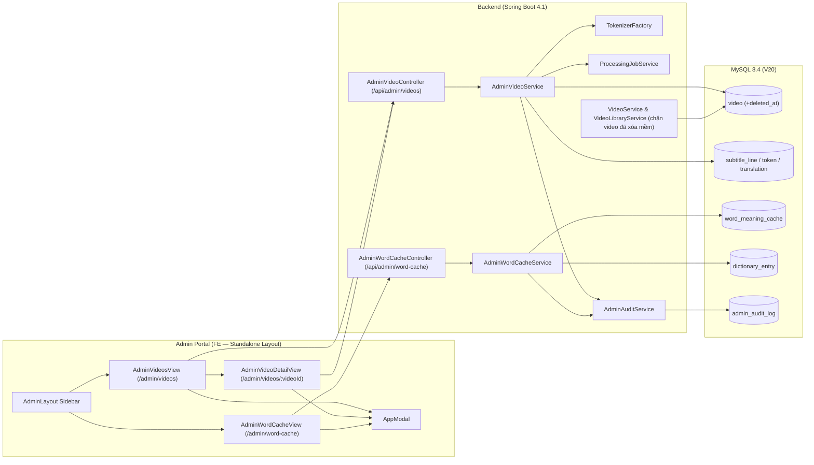

# Kế hoạch Triển khai: Admin Management Module — Phase 2 (Chất lượng nội dung)

## Goal Description

Triển khai **Phase 2 (Chất lượng nội dung)** của phân hệ quản trị (**Admin Portal**) dựa trên `_specs/admin-management-module.md`, bao gồm:

1. **Module 4 — Quản lý Video, Phụ đề & Bản dịch (Videos & Subtitles)**:
   - Bổ sung cơ chế **Xóa mềm (`deleted_at`, `deleted_by_admin_id`)** và **Khôi phục (`Restore`)** trên `Video` để bảo toàn `DictionaryEntryContext` đã lưu của người dùng.
   - Ẩn video đã xóa mềm khỏi toàn bộ giao diện người học (`VideoLibraryService`, `VideoService.getHistory`, `VideoService.getVideo`, `SubtitleService`) và **chặn user submit lại** `youtube_video_id` đã bị xóa mềm với thông báo rõ ràng (*"Video hiện không khả dụng"*).
   - Màn hình quản trị danh sách Video (lọc theo tìm kiếm, `status`, `sourceLanguage`, `failureReason`, `visibility`) và trang Chi tiết Video:
     - Xem metadata, ngôn ngữ đã dịch, lịch sử `ProcessingJob`, và bảng kiểm tra phụ đề phân trang server-side kèm token NLP (`SubtitleToken`) & bản dịch (`SubtitleLineTranslation`).
     - **Chỉnh sửa thủ công cả `sourceText` lẫn `targetText`**: sửa `sourceText` giữ nguyên `SubtitleLine.id` và tự động chạy lại `TokenizerFactory` đúng ngôn ngữ để tái tạo `SubtitleToken`; có khóa kiểm tra xung đột khi video đang có job `PENDING`/`PROCESSING`.
     - **Re-ingest** phụ đề gốc, **Force Re-translate** theo ngôn ngữ đích, và **Xóa bản dịch** một ngôn ngữ mà không ảnh hưởng phụ đề gốc.
   - Cập nhật chỉ số `deleted` video trên Dashboard Phase 1 (`AdminDashboardService` & `AdminDashboardView`).

2. **Module 6 — Quản lý Cache AI & Phân tích Từ điển (Word Cache & Dictionary Insights)**:
   - Danh sách `word_meaning_cache` phân trang server-side, tìm theo `normalizedWord`, lọc theo `status` (`READY` / `FAILED`) và cặp ngôn ngữ nguồn–đích.
   - **Dọn hàng loạt cache `FAILED`** chỉ với 1 nút bấm (không ảnh hưởng bản ghi `READY`), **xóa 1 bản ghi cache cụ thể**, và **chỉnh sửa thủ công** `contextualMeaning`, `dictionaryMeaning`, `examples` (chuyển trạng thái sang `READY`).
   - **Thống kê tổng hợp từ vựng (Dictionary Insights)**: Top từ được lưu nhiều nhất và phân bố theo cặp ngôn ngữ trên `dictionary_entry` — chỉ tổng hợp số liệu, tuyệt đối không hiển thị dữ liệu từ điển cá nhân của từng user.

3. **Nhất quán với chuẩn Phase 1**:
   - Mọi thao tác mutate của Admin đều ghi nhận tự động vào `admin_audit_log` qua `AdminAuditService`.
   - Mọi thao tác xác nhận / cảnh báo trên FE đều hiển thị qua popup `FE/src/components/common/AppModal.vue`.



---

## User Review Required

> [!IMPORTANT]
> **Xung đột khi Admin chỉnh sửa phụ đề / xóa bản dịch lúc đang có job chạy:**
> - Khi Admin chỉnh sửa `sourceText` hoặc `targetText` (hoặc xóa bản dịch một ngôn ngữ), backend sẽ kiểm tra bảng `processing_job`: nếu đang có job `INGEST_VIDEO` trạng thái `PENDING`/`PROCESSING` (hoặc job `TRANSLATE_SUBTITLES` / `RETRANSLATE_SUBTITLES` đang chạy cho đúng `targetLanguage` đó), API sẽ trả về `409 Conflict` (`ACTIVE_JOB_CONFLICT`) và hiển thị cảnh báo qua `AppModal` để tránh bị worker ghi đè dữ liệu vừa sửa.

> [!NOTE]
> **Xóa mềm Video và hành vi với dữ liệu người dùng:**
> - Khi Admin xóa mềm một `Video`, bản ghi vẫn giữ nguyên trong DB (`deleted_at` được gán timestamp) nên toàn bộ `DictionaryEntryContext` của người dùng không bị mất hay lỗi khóa ngoại.
> - Video bị ẩn khỏi thư viện (`VideoLibraryService.list`), lịch sử xem (`VideoService.getHistory`), và bị chặn khi mở xem/lấy phụ đề (`404 VIDEO_NOT_FOUND`).
> - Khi user dán lại link YouTube của video đã bị xóa mềm, `VideoService.submitVideo` trả về `409 Conflict` với mã `VIDEO_UNAVAILABLE` và thông báo *"Video hiện không khả dụng"* — chỉ Admin mới có thể bấm **Khôi phục (Restore)**.

---

## Proposed Changes

### 1. Database Migration & Domain Layer

#### [NEW] `BE/SubLearn/src/main/resources/db/migration/V20__add_video_soft_delete_and_phase2_indexes.sql`
- Thêm cột `deleted_at DATETIME(6) NULL` và `deleted_by_admin_id BIGINT NULL` (`FK -> app_user(id) ON DELETE SET NULL`) vào bảng `video`.
- Thêm các index tối ưu lọc server-side và tổng hợp dữ liệu:
  - `idx_video_deleted_status` trên `video (deleted_at, status)`
  - `idx_word_cache_status_lang` trên `word_meaning_cache (status, source_language, target_language)`
  - `idx_dictionary_entry_word_lang` trên `dictionary_entry (normalized_word, source_language, target_language)`

```sql
ALTER TABLE video
    ADD COLUMN deleted_at DATETIME(6) NULL,
    ADD COLUMN deleted_by_admin_id BIGINT NULL,
    ADD CONSTRAINT fk_video_deleted_by_admin
        FOREIGN KEY (deleted_by_admin_id) REFERENCES app_user (id) ON DELETE SET NULL;

CREATE INDEX idx_video_deleted_status ON video (deleted_at, status);
CREATE INDEX idx_word_cache_status_lang ON word_meaning_cache (status, source_language, target_language);
CREATE INDEX idx_dictionary_entry_word_lang ON dictionary_entry (normalized_word, source_language, target_language);
```

#### [MODIFY] [Video.java](file:///c:/Users/Admin/Documents/GitHub/SubLearn/BE/SubLearn/src/main/java/org/example/sublearn/domain/Video.java)
- Bổ sung trường `deletedAt` (`Instant`) và `deletedByAdmin` (`@ManyToOne(fetch = FetchType.LAZY) AppUser`).
- Bổ sung helper `isDeleted()`, `softDelete(AppUser admin)`, `restore()`.

#### [MODIFY] [SubtitleLine.java](file:///c:/Users/Admin/Documents/GitHub/SubLearn/BE/SubLearn/src/main/java/org/example/sublearn/domain/SubtitleLine.java)
- Bổ sung `setSourceText(String sourceText)` để cập nhật tại chỗ mà vẫn giữ nguyên `SubtitleLine.id`.

#### [MODIFY] [SubtitleLineTranslation.java](file:///c:/Users/Admin/Documents/GitHub/SubLearn/BE/SubLearn/src/main/java/org/example/sublearn/domain/SubtitleLineTranslation.java)
- Bổ sung `setTranslatedText(String translatedText)`.

#### [MODIFY] [WordMeaningCache.java](file:///c:/Users/Admin/Documents/GitHub/SubLearn/BE/SubLearn/src/main/java/org/example/sublearn/domain/WordMeaningCache.java)
- Bổ sung `getExpiresAt()` và `updateManually(String contextualMeaning, String dictionaryMeaning, List<String> examples)` (cập nhật nội dung, đặt `status = WordMeaningStatus.READY` và cập nhật `lastFetchedAt`).

#### [MODIFY] [AdminAuditAction.java](file:///c:/Users/Admin/Documents/GitHub/SubLearn/BE/SubLearn/src/main/java/org/example/sublearn/domain/AdminAuditAction.java)
- Bổ sung các enum action mới cho Phase 2:
  `SOFT_DELETE_VIDEO`, `RESTORE_VIDEO`, `REINGEST_VIDEO`, `RETRANSLATE_VIDEO`, `DELETE_VIDEO_TRANSLATION`, `EDIT_SUBTITLE_LINE`, `EDIT_WORD_CACHE`, `DELETE_WORD_CACHE`, `PURGE_FAILED_WORD_CACHE`.

---

### 2. Soft Delete Enforcement & Repository Extensions

#### [MODIFY] [VideoRepository.java](file:///c:/Users/Admin/Documents/GitHub/SubLearn/BE/SubLearn/src/main/java/org/example/sublearn/repository/VideoRepository.java)
- Bổ sung:
  - `long countByDeletedAtIsNull()` và `long countByDeletedAtIsNotNull()`
  - `long countByStatusAndDeletedAtIsNull(VideoStatus status)`
  - `@EntityGraph(attributePaths = {"requestedByUser", "deletedByAdmin"}) Page<Video> searchAdminVideos(...)` lọc theo `search` (title / `youtubeVideoId` / `requestedByUser.email`), `status`, `sourceLanguage`, `failureReason`, và `visibility` (`ACTIVE` / `DELETED` / `ALL`).

#### [MODIFY] [SubtitleLineRepository.java](file:///c:/Users/Admin/Documents/GitHub/SubLearn/BE/SubLearn/src/main/java/org/example/sublearn/repository/SubtitleLineRepository.java)
- Bổ sung `Optional<SubtitleLine> findByIdAndVideo_Id(Long lineId, Long videoId)` và query tìm kiếm phân trang theo `video` + `search` (tìm trong `sourceText` hoặc `translatedText` của `targetLanguage`).

#### [MODIFY] [SubtitleTokenRepository.java](file:///c:/Users/Admin/Documents/GitHub/SubLearn/BE/SubLearn/src/main/java/org/example/sublearn/repository/SubtitleTokenRepository.java)
- Bổ sung `void deleteBySubtitleLine(SubtitleLine subtitleLine)`.

#### [MODIFY] [SubtitleLineTranslationRepository.java](file:///c:/Users/Admin/Documents/GitHub/SubLearn/BE/SubLearn/src/main/java/org/example/sublearn/repository/SubtitleLineTranslationRepository.java)
- Bổ sung:
  - `@Query("SELECT DISTINCT t.targetLanguage FROM SubtitleLineTranslation t WHERE t.subtitleLine.video.id = :videoId ORDER BY t.targetLanguage ASC") List<String> findDistinctTargetLanguagesByVideoId(@Param("videoId") Long videoId)`
  - Query batch lấy danh sách ngôn ngữ đã dịch cho nhiều `videoId` (tránh N+1 trên trang danh sách Video).
  - `long deleteBySubtitleLine_VideoAndTargetLanguage(Video video, String targetLanguage)` (hoặc đếm trước khi xóa).

#### [MODIFY] [UserVideoRepository.java](file:///c:/Users/Admin/Documents/GitHub/SubLearn/BE/SubLearn/src/main/java/org/example/sublearn/repository/UserVideoRepository.java)
- Bổ sung:
  - `@EntityGraph(attributePaths = "video") Page<UserVideo> findByUser_IdAndVideo_StatusAndVideo_DeletedAtIsNull(Long userId, VideoStatus status, Pageable pageable)`
  - `long countByVideo_Id(Long videoId)` và query batch `countByVideoIds(List<Long> videoIds)` cho danh sách Admin Videos.

#### [MODIFY] [VideoWatchHistoryRepository.java](file:///c:/Users/Admin/Documents/GitHub/SubLearn/BE/SubLearn/src/main/java/org/example/sublearn/repository/VideoWatchHistoryRepository.java)
- Bổ sung `List<VideoWatchHistory> findTop50ByUserAndVideo_DeletedAtIsNullOrderByLastWatchedAtDesc(AppUser user)`.

#### [MODIFY] [ProcessingJobRepository.java](file:///c:/Users/Admin/Documents/GitHub/SubLearn/BE/SubLearn/src/main/java/org/example/sublearn/repository/ProcessingJobRepository.java)
- Bổ sung:
  - `boolean existsByVideo_IdAndJobTypeInAndStatusIn(Long videoId, Collection<JobType> jobTypes, Collection<JobStatus> statuses)`
  - `boolean existsByVideo_IdAndJobTypeInAndTargetLanguageAndStatusIn(Long videoId, Collection<JobType> jobTypes, String targetLanguage, Collection<JobStatus> statuses)`
  - `@EntityGraph(attributePaths = {"requestedByUser"}) List<ProcessingJob> findTop20ByVideo_IdOrderByCreatedAtDesc(Long videoId)`

#### [MODIFY] [WordMeaningCacheRepository.java](file:///c:/Users/Admin/Documents/GitHub/SubLearn/BE/SubLearn/src/main/java/org/example/sublearn/repository/WordMeaningCacheRepository.java)
- Bổ sung:
  - `@Query(...) Page<WordMeaningCache> searchAdminCache(@Param("search") String search, @Param("status") WordMeaningStatus status, @Param("sourceLanguage") String sourceLanguage, @Param("targetLanguage") String targetLanguage, Pageable pageable)`
  - `long deleteByStatus(WordMeaningStatus status)`

#### [MODIFY] [DictionaryEntryRepository.java](file:///c:/Users/Admin/Documents/GitHub/SubLearn/BE/SubLearn/src/main/java/org/example/sublearn/repository/DictionaryEntryRepository.java)
- Bổ sung các query tổng hợp (không lộ thông tin user):
  - `countDistinctNormalizedWords()`
  - `countDistinctUsers()`
  - `findTopSavedWords(Pageable pageable)` -> `(normalizedWord, sourceLanguage, targetLanguage, COUNT(e))`
  - `countByLanguagePair()` -> `(sourceLanguage, targetLanguage, COUNT(e))`

#### [MODIFY] [VideoService.java](file:///c:/Users/Admin/Documents/GitHub/SubLearn/BE/SubLearn/src/main/java/org/example/sublearn/video/VideoService.java) & [VideoLibraryService.java](file:///c:/Users/Admin/Documents/GitHub/SubLearn/BE/SubLearn/src/main/java/org/example/sublearn/video/VideoLibraryService.java) & [AdminJobService.java](file:///c:/Users/Admin/Documents/GitHub/SubLearn/BE/SubLearn/src/main/java/org/example/sublearn/admin/AdminJobService.java)
- `VideoService.submitVideo`: nếu `video != null && video.isDeleted()`, ném `ApiException.conflict("VIDEO_UNAVAILABLE", "Video hiện không khả dụng")`.
- `VideoService.getVideo`: nếu `video.isDeleted()`, ném `ApiException.notFound("VIDEO_NOT_FOUND", "Video hiện không khả dụng")`.
- `VideoService.getHistory`: dùng `findTop50ByUserAndVideo_DeletedAtIsNullOrderByLastWatchedAtDesc`.
- `VideoLibraryService.list`: dùng `findByUser_IdAndVideo_StatusAndVideo_DeletedAtIsNull`.
- `VideoLibraryService.updateProgress`: chặn nếu `video.isDeleted()`.
- `AdminJobService.retryJob` / `bulkRetryJobs`: bỏ qua / từ chối retry nếu `job.getVideo().isDeleted()`.

#### [MODIFY] [AdminDashboardService.java](file:///c:/Users/Admin/Documents/GitHub/SubLearn/BE/SubLearn/src/main/java/org/example/sublearn/admin/AdminDashboardService.java) & [AdminDashboardOverviewResponse.java](file:///c:/Users/Admin/Documents/GitHub/SubLearn/BE/SubLearn/src/main/java/org/example/sublearn/admin/dto/AdminDashboardOverviewResponse.java)
- Bổ sung trường `long deleted` vào `VideoKpis` và đếm `ready/processing/pending/failed` trên các video chưa xóa mềm (`deletedAt == null`).

---

### 3. Backend Module 4 — Admin Video, Subtitle & Translation APIs

#### [NEW] DTOs trong `BE/SubLearn/src/main/java/org/example/sublearn/admin/dto/`
- `AdminVideoSummaryDto.java`
- `AdminVideoPageResponse.java`
- `AdminVideoDetailResponse.java`
- `AdminSubtitleTokenDto.java`
- `AdminSubtitleLineDto.java`
- `AdminSubtitlePageResponse.java`
- `UpdateSubtitleLineRequest.java`
- `AdminReingestVideoRequest.java`
- `AdminRetranslateVideoRequest.java`
- `DeleteTranslationResponse.java`

#### [NEW] `BE/SubLearn/src/main/java/org/example/sublearn/admin/AdminVideoService.java`
- `listVideos(search, status, sourceLanguage, failureReason, visibility, page, size)`: phân trang + batch load `availableTranslationLanguages` và `savedByUserCount`.
- `getVideoDetail(videoId)`: chi tiết video + `availableTranslationLanguages` + `savedByUserCount` + `recentJobs`.
- `getSubtitles(videoId, targetLanguage, search, page, size)`: phân trang server-side các `SubtitleLine` kèm `SubtitleToken` và `translatedText`.
- `updateSubtitleLine(videoId, lineId, request, adminUserId, clientIp)`:
  - Kiểm tra video không bị xóa mềm và không có active job xung đột.
  - Nếu sửa `sourceText`: cập nhật `line.setSourceText(...)` (giữ nguyên `line.getId()`), xóa token cũ (`deleteBySubtitleLine` + `flush()`), chạy lại `tokenizerFactory.get(video.getSourceLanguage()).tokenize(newText)` và lưu lại toàn bộ `SubtitleToken`.
  - Nếu có `targetLanguage` + `targetText`: cập nhật hoặc tạo mới `SubtitleLineTranslation`.
  - Ghi audit log `EDIT_SUBTITLE_LINE`.
- `reingestVideo(videoId, request, adminUserId, clientIp)`: kiểm tra không bị xóa mềm & không có active ingest job -> reset trạng thái `PENDING` -> `processingJobService.createAndEnqueue(..., JobType.INGEST_VIDEO, ...)` -> ghi audit log `REINGEST_VIDEO`.
- `retranslateVideo(videoId, targetLanguage, adminUserId, clientIp)`: kiểm tra video `READY`, không bị xóa mềm, `targetLanguage` hợp lệ và khác `sourceLanguage` -> `processingJobService.createAndEnqueue(..., JobType.RETRANSLATE_SUBTITLES, ...)` -> ghi audit log `RETRANSLATE_VIDEO`.
- `deleteTranslation(videoId, targetLanguage, adminUserId, clientIp)`: kiểm tra không có active translation job cho ngôn ngữ đó -> xóa bản dịch `targetLanguage` -> ghi audit log `DELETE_VIDEO_TRANSLATION`.
- `softDeleteVideo(videoId, adminUserId, clientIp)` & `restoreVideo(videoId, adminUserId, clientIp)`: cập nhật `deletedAt`/`deletedByAdmin` -> ghi audit log `SOFT_DELETE_VIDEO` / `RESTORE_VIDEO`.

#### [NEW] `BE/SubLearn/src/main/java/org/example/sublearn/admin/AdminVideoController.java`
- Mapping `/api/admin/videos`:
  - `GET /api/admin/videos`
  - `GET /api/admin/videos/{videoId}`
  - `GET /api/admin/videos/{videoId}/subtitles`
  - `PATCH /api/admin/videos/{videoId}/subtitles/{lineId}`
  - `POST /api/admin/videos/{videoId}/reingest`
  - `POST /api/admin/videos/{videoId}/retranslate`
  - `DELETE /api/admin/videos/{videoId}/translations/{targetLanguage}`
  - `POST /api/admin/videos/{videoId}/soft-delete`
  - `POST /api/admin/videos/{videoId}/restore`

---

### 4. Backend Module 6 — Admin Word Cache & Dictionary Insights APIs

#### [NEW] DTOs trong `BE/SubLearn/src/main/java/org/example/sublearn/admin/dto/`
- `AdminWordCacheItemDto.java`
- `AdminWordCachePageResponse.java`
- `UpdateWordCacheRequest.java`
- `PurgeWordCacheResponse.java`
- `AdminDictionaryInsightsResponse.java` (gồm `totalEntries`, `uniqueWords`, `totalUsersWithDictionary`, `topSavedWords`, `languagePairs`)

#### [NEW] `BE/SubLearn/src/main/java/org/example/sublearn/admin/AdminWordCacheService.java`
- `listCache(search, status, sourceLanguage, targetLanguage, page, size)`
- `updateCache(id, request, adminUserId, clientIp)`: chỉnh sửa thủ công `contextualMeaning`, `dictionaryMeaning`, `examples` (chuyển sang `READY`), ghi audit log `EDIT_WORD_CACHE`.
- `deleteCache(id, adminUserId, clientIp)`: xóa 1 bản ghi, ghi audit log `DELETE_WORD_CACHE`.
- `purgeFailedCache(adminUserId, clientIp)`: xóa toàn bộ bản ghi `FAILED`, giữ nguyên `READY`, ghi audit log `PURGE_FAILED_WORD_CACHE`.
- `getDictionaryInsights()`: truy vấn số liệu tổng hợp (top 20 từ lưu nhiều nhất, phân bố cặp ngôn ngữ) — tuyệt đối không trả thông tin cá nhân người dùng.

#### [NEW] `BE/SubLearn/src/main/java/org/example/sublearn/admin/AdminWordCacheController.java`
- Mapping `/api/admin/word-cache`:
  - `GET /api/admin/word-cache`
  - `PATCH /api/admin/word-cache/{id}`
  - `DELETE /api/admin/word-cache/{id}`
  - `DELETE /api/admin/word-cache/failed`
  - `GET /api/admin/word-cache/dictionary-insights`

---

### 5. Frontend — Admin Videos, Subtitle Editor & Word Cache UI

#### [MODIFY] [api.ts](file:///c:/Users/Admin/Documents/GitHub/SubLearn/FE/src/types/api.ts) & [admin.api.ts](file:///c:/Users/Admin/Documents/GitHub/SubLearn/FE/src/api/admin.api.ts)
- Bổ sung toàn bộ TypeScript interfaces cho Module 4 & Module 6 và trường `deleted` trong `AdminDashboardOverviewResponse.videos`.
- Bổ sung các hàm gọi API tương ứng vào `adminApi`.

#### [MODIFY] [router/index.ts](file:///c:/Users/Admin/Documents/GitHub/SubLearn/FE/src/router/index.ts) & [AdminLayout.vue](file:///c:/Users/Admin/Documents/GitHub/SubLearn/FE/src/components/admin/AdminLayout.vue)
- Bổ sung 3 child route dưới `/admin`:
  - `videos` (`admin-videos` -> `AdminVideosView.vue`)
  - `videos/:videoId` (`admin-video-detail` -> `AdminVideoDetailView.vue`)
  - `word-cache` (`admin-word-cache` -> `AdminWordCacheView.vue`)
- Bổ sung 2 mục menu vào sidebar của `AdminLayout.vue` (🎬 *Quản lý Video & Phụ đề*, 📖 *Cache AI & Từ điển*) và tiêu đề breadcrumb tương ứng.

#### [MODIFY] [AdminDashboardView.vue](file:///c:/Users/Admin/Documents/GitHub/SubLearn/FE/src/views/admin/AdminDashboardView.vue)
- Hiển thị thêm số lượng video **Đã xóa mềm** trên thẻ KPI Video.

#### [NEW] `FE/src/views/admin/AdminVideosView.vue`
- Bộ lọc: tìm kiếm (tiêu đề / YouTube ID / email người gửi), trạng thái (`READY`/`PROCESSING`/`PENDING`/`FAILED`), ngôn ngữ nguồn, `failureReason`, trạng thái hiển thị (`Tất cả` / `Đang hoạt động` / `Đã xóa mềm`).
- Bảng phân trang hiển thị tiêu đề, YouTube ID, trạng thái, ngôn ngữ gốc & các bản dịch hiện có, số user đã lưu, nút **Chi tiết** và **Xóa mềm / Khôi phục** (xác nhận qua `AppModal`).

#### [NEW] `FE/src/views/admin/AdminVideoDetailView.vue`
- Khu vực thông tin Video + nút thao tác nhanh: **Tải lại phụ đề gốc (Re-ingest)**, **Dịch lại theo ngôn ngữ (Force Re-translate)**, **Xóa mềm / Khôi phục** (tất cả xác nhận qua `AppModal`).
- Danh sách các bản dịch hiện có theo từng ngôn ngữ kèm nút **Dịch lại** và **Xóa bản dịch**.
- **Trình kiểm tra & Chỉnh sửa phụ đề (phân trang server-side)**:
  - Chọn ngôn ngữ đích đang xem, ô tìm kiếm câu phụ đề.
  - Hiển thị từng dòng phụ đề: số thứ tự, timestamp, `sourceText`, danh sách chip `SubtitleToken` (có thể bật/tắt xem token NLP), và `targetText`.
  - Hỗ trợ mở chế độ chỉnh sửa trực tiếp `sourceText` (có chú thích tự động re-tokenize NLP) và `targetText`, báo lỗi xung đột job qua `AppModal`.
- Bảng lịch sử `ProcessingJob` gần nhất của video.

#### [NEW] `FE/src/views/admin/AdminWordCacheView.vue`
- Hai tab rõ ràng:
  1. **Cache Tra từ AI (`word_meaning_cache`)**:
     - Bộ lọc theo từ (`normalizedWord`), trạng thái (`READY`/`FAILED`), ngôn ngữ nguồn & đích.
     - Nút **Dọn toàn bộ cache FAILED** (xác nhận qua `AppModal`).
     - Bảng phân trang hiển thị từ, cặp ngôn ngữ, trạng thái, nghĩa ngữ cảnh, nghĩa từ điển, ví dụ, `lastFetchedAt`, nút **Sửa** (mở form modal chỉnh `contextualMeaning`, `dictionaryMeaning`, `examples`) và **Xóa** (xác nhận qua `AppModal`).
  2. **Thống kê Từ điển (Dictionary Insights)**:
     - Thẻ KPI tổng số từ đã lưu, số từ duy nhất, số người dùng có từ điển.
     - Bảng Top 20 từ được lưu nhiều nhất và biểu đồ/bảng phân bố theo cặp ngôn ngữ.

---

## Verification Plan

### Automated Tests
1. **Backend Unit & Service Tests** (`cd BE\SubLearn; .\mvnw.cmd test`):
   - `[NEW]` `AdminVideoServiceTest.java`:
     - Xóa mềm video ẩn video khỏi `VideoService.getVideo` / `VideoLibraryService.list`, chặn `VideoService.submitVideo` với `VIDEO_UNAVAILABLE`, giữ nguyên `DictionaryEntryContext`, và `restoreVideo` khôi phục thành công.
     - Sửa `sourceText` giữ nguyên `SubtitleLine.id`, gọi `TokenizerFactory` đúng `sourceLanguage` và thay thế danh sách `SubtitleToken`.
     - Sửa `targetText` cập nhật/tạo mới `SubtitleLineTranslation`; từ chối sửa khi đang có job active (`409 ACTIVE_JOB_CONFLICT`).
     - Xóa bản dịch chỉ xóa đúng `targetLanguage`, không ảnh hưởng `SubtitleLine`.
     - Re-ingest / Re-translate tạo job mới và ghi đầy đủ `admin_audit_log`.
   - `[NEW]` `AdminWordCacheServiceTest.java`:
     - Chỉnh sửa thủ công cache chuyển trạng thái sang `READY` và ghi audit log.
     - Dọn cache `FAILED` chỉ xóa bản ghi `FAILED` và giữ nguyên bản ghi `READY`.
     - Xóa 1 bản ghi cache và kiểm tra `getDictionaryInsights` trả về top từ & phân bố cặp ngôn ngữ tổng hợp.
   - `[MODIFY]` `AdminDashboardServiceTest.java`: xác minh `VideoKpis.deleted`.
2. **Frontend Unit Tests & Build** (`npm.cmd --prefix FE run type-check; npm.cmd --prefix FE test; npm.cmd --prefix FE run build`):
   - `[NEW]` `tests/AdminVideosView.spec.ts`: lọc danh sách, xác nhận xóa mềm / khôi phục qua `AppModal`.
   - `[NEW]` `tests/AdminVideoDetailView.spec.ts`: tải phụ đề + token, sửa `sourceText`/`targetText`, xóa bản dịch qua `AppModal`.
   - `[NEW]` `tests/AdminWordCacheView.spec.ts`: lọc cache, dọn hàng loạt `FAILED` qua `AppModal`, chỉnh sửa nghĩa thủ công, và chuyển tab xem Dictionary Insights.

### Manual Verification
1. Đăng nhập tài khoản `ADMIN` -> vào thẳng Admin Portal -> mở mục **Quản lý Video & Phụ đề**:
   - Thử xóa mềm một video -> chuyển sang tài khoản `USER`, xác nhận video biến mất khỏi Thư viện/Lịch sử, dán lại link YouTube đó thấy báo lỗi *"Video hiện không khả dụng"*, nhưng từ đã lưu trong Từ điển vẫn giữ nguyên ngữ cảnh.
   - Quay lại Admin bấm **Khôi phục (Restore)** -> video khả dụng trở lại.
   - Vào **Chi tiết Video** -> sửa 1 câu `sourceText` và `targetText` -> kiểm tra danh sách token NLP tự động cập nhật và mở `WatchView` thấy nội dung mới ngay lập tức.
2. Mở mục **Cache AI & Từ điển**:
   - Sửa nghĩa của 1 bản ghi cache -> tra lại từ đó ở `WatchView` thấy nghĩa mới trả ra ngay từ cache.
   - Bấm **Dọn toàn bộ cache FAILED** -> xác nhận qua popup modal -> chỉ các bản ghi `FAILED` bị xóa.
   - Chuyển sang tab **Thống kê Từ điển** -> kiểm tra Top từ và phân bố cặp ngôn ngữ hiển thị chính xác, không có dữ liệu riêng tư của user.
